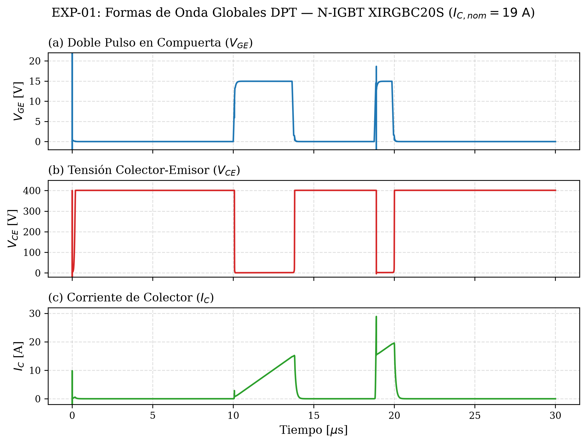
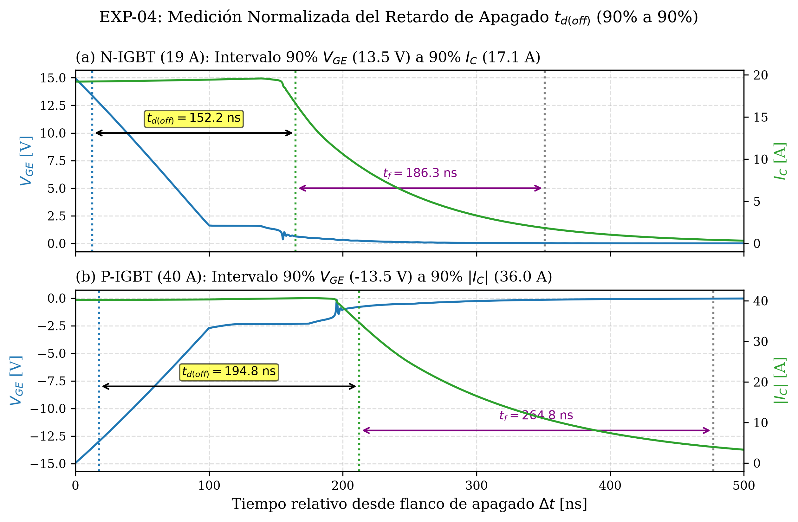
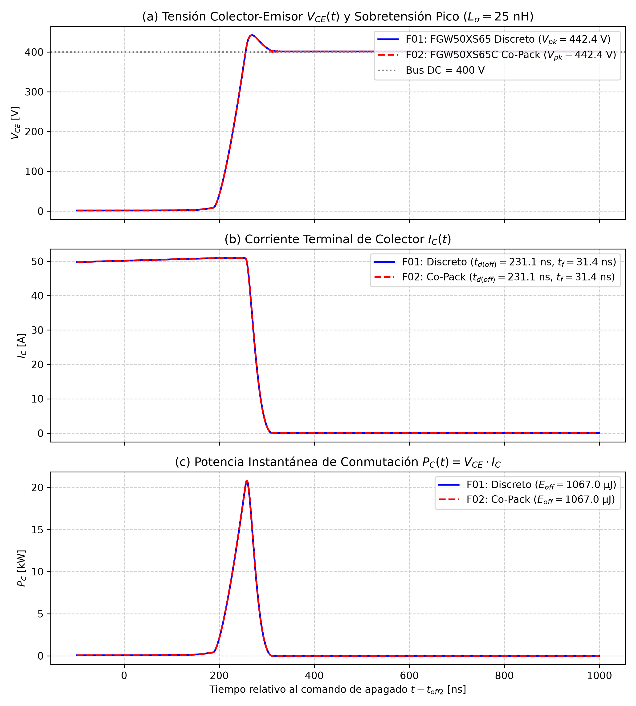
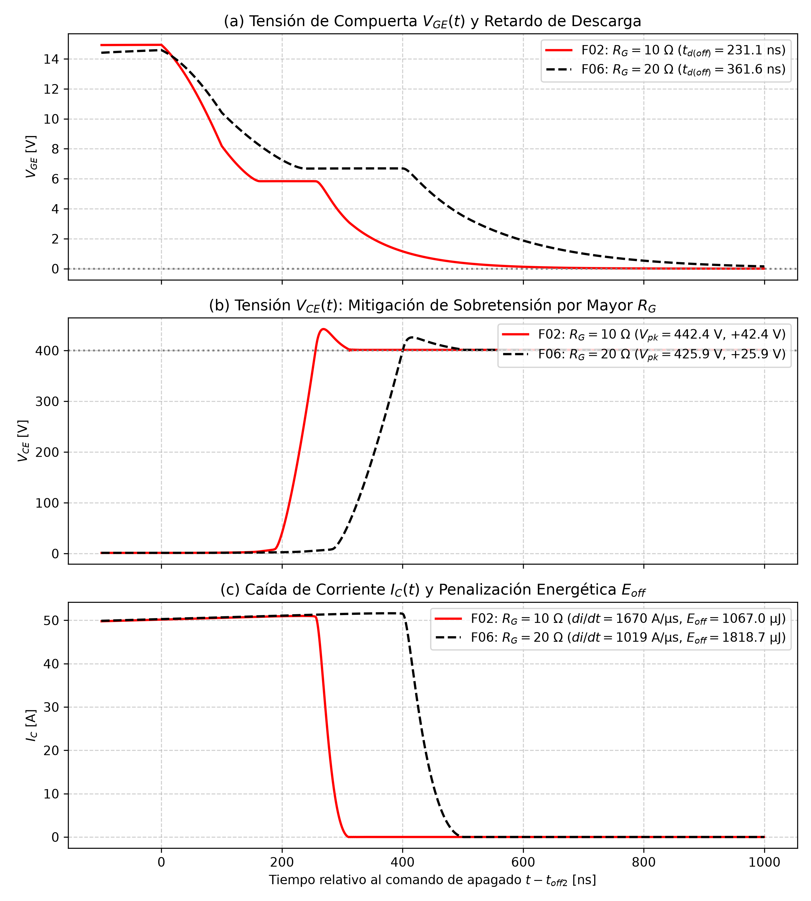

# Laboratory Project No. 3: Comparative Characterization and Simulation of IGBT Transistors in LTspice

**Institution:** Universidad Nacional Mayor de San Marcos (UNMSM) — FIEE  
**Course:** Microelectronics and Nanoelectronic Systems (2026-II)  
**Author:** **Leonardo Sait Yactayo Tolentino** (`23190214`) — *Individual Project*  
**Official Technical Report (Spanish, 15 pages):** [`informe/informe_ld3_yactayo.pdf`](informe/informe_ld3_yactayo.pdf)  
**Presentation Deck:** [`presentacion/LD3_IGBT_Yactayo.pdf`](presentacion/LD3_IGBT_Yactayo.pdf) | [`presentacion/LD3_IGBT_Yactayo.pptx`](presentacion/LD3_IGBT_Yactayo.pptx)

---

## Overview

This project characterizes the static and inductive switching dynamics of Insulated Gate Bipolar Transistors (IGBTs) in **LTspice** using a **Double Pulse Test (DPT)** bench ($V_{bus} = \pm 400\text{ V}$, $L_{\text{load}} = 100\ \mu\text{H}$). It compares classical behavioral N-channel and P-channel macromodels (Duncan Electronics) against commercial 650 V Trench Field-Stop IGBTs (Fuji Electric X-Series, 50 A and 75 A, discrete and co-packaged diode variants).

---

## DPT Methodology & Experiments

1. **Part I — Duncan Electronics Behavioral Models (`EXP-01` to `EXP-05`):**
   * **N-IGBT Low-Side (`XIRGBC20S`, 600 V / 19 A):** $V_{bus} = +400\text{ V}$, $V_{GE} = 0 \to +15\text{ V}$, $R_G = 10\ \Omega$, emitter shunt $R_E = 1\text{ m}\Omega$, $L_\sigma = 0\text{ nH}$, $T = 27\ ^\circ\text{C}$.
   * **P-IGBT High-Side (`XPIGBT`, 600 V / 40 A):** $V_{bus} = -400\text{ V}$, $V_{GE} = 0 \to -15\text{ V}$, $R_G = 10\ \Omega$, corrected freewheeling diode polarity.
   * **Metrics:** Turn-off delay $t_{d(\text{off})}$ (90% $V_{GE}$ to 90% $I_C$), fall time $t_f$, turn-off energy $E_{\text{off}} = \int V_{CE} I_C\,dt$, and tail current inflection ($|dI_C/dt| \le 5\% |dI/dt|_{\max}$).
2. **Part II — Fuji Electric X-Series 650 V Trench-FS (`EXP-06` to `EXP-09`):**
   * **Terminal-Isolated Sensing (G4.2-R):** Ideal 0 V sensors (`Vsens_C`, `Vsens_G`, `Vsens_E`) isolate collector current $I_C$ from gate displacement current.
   * **Parasitic Loop Inductance:** $L_\sigma = 25\text{ nH}$ ($R_{\text{ser}} = 10\text{ m}\Omega$, no artificial parallel damping `Rpar`), Gear integration (`maxstep = 1.0 ns`), $T = 25\ ^\circ\text{C}$.
   * **Studies:** Co-pack diode impact at 50 A (`FGW50XS65` vs. `FGW50XS65C`) and 75 A (`FGW75XS65` vs. `FGW75XS65C`), silicon die-area scaling (50 A vs. 75 A), and gate resistance sensitivity ($R_G = 10\ \Omega \to 20\ \Omega$).

---

## Key Results (Consolidated Master Table)

> [!IMPORTANT]
> Direct quantitative comparisons should be made **within each model family** due to different instrumentation setups (emitter shunt vs. isolated `Vsens_C`, $L_\sigma = 0\text{ nH}$ vs. $25\text{ nH}$, $27\ ^\circ\text{C}$ vs. $25\ ^\circ\text{C}$). See [`tablas/tabla_resultados_ld3.md`](tablas/tabla_resultados_ld3.md) for full details.

| Reg. | Family / Test | Configuration | Model | $I_{C,\text{pre}}$ [A] | $V_{CE(\text{on})}$ [V] | $V_{CE,\text{peak}}$ [V] | $t_{d(\text{off})}$ [ns] | $t_f$ [ns] | $E_{\text{off}}$ [µJ] | $I_{C,\text{tail}}$ [A] | $\%E_{\text{tail}}$ | Status |
| :---: | :--- | :--- | :--- | :---: | :---: | :---: | :---: | :---: | :---: | :---: | :---: | :---: |
| **01** | Duncan (`EXP-01/04`) | N-IGBT Nominal | `XIRGBC20S` | 19.00 | 1.88 | 400.99 | 150.83 | 185.24 | 691.5 | 0.94 | 4.73% | **PASS** |
| **02** | Duncan (`EXP-01/05`) | N-IGBT Overcurrent | `XIRGBC20S` | 82.31 | 6.57 | 401.66 | 103.32 | 196.03 | 3402.5 | 2.31 | 2.25% | **Exploratory (Out-of-SOA)** |
| **03** | Duncan (`EXP-02/04`) | P-IGBT Nominal | `XPIGBT` | 40.02 | 2.51 | 401.22 | 194.57 | 268.42 | 2115.3 | 1.81 | 4.33% | **PASS** |
| **04** | Duncan (`EXP-02/05`) | P-IGBT Overcurrent | `XPIGBT` | 83.22 | 4.25 | 401.67 | 172.32 | 275.03 | 4698.9 | 2.86 | 2.99% | **Exploratory (Out-of-SOA)** |
| **05** | Duncan (`EXP-02 Ctrl`) | P-IGBT Control 19A | `XPIGBT` | 19.48 | 1.72 | 401.01 | **N/V\*** | **N/V\*** | 1011.8 | **N/V\*** | **N/V\*** | **KNOWN LIMITATION (`N/V*`)** |
| **06** | Fuji (`F01 / EXP-06`) | 50A Discrete | `FGW50XS65` | 50.013 | 1.362 | 442.36 | 231.10 | 31.38 | 1066.98 | 2.50 | 0.44% | **PASS** |
| **07** | Fuji (`F02 / EXP-06/09`) | 50A Co-Pack ($R_G 10$) | `FGW50XS65C` | 50.012 | 1.362 | 442.36 | 231.09 | 31.38 | 1066.98 | 2.50 | 0.44% | **PASS** |
| **08** | Fuji (`F03 / EXP-07/08`) | 75A Discrete Nom. | `FGW75XS65` | 75.230 | 1.356 | 445.98 | 293.18 | 40.48 | 2052.75 | 3.76 | 0.37% | **PASS** |
| **09** | Fuji (`F04 / EXP-07`) | 75A Co-Pack Nom. | `FGW75XS65C` | 75.233 | 1.356 | 445.98 | 293.16 | 40.48 | 2052.74 | 3.76 | 0.37% | **PASS** |
| **10** | Fuji (`F05 / EXP-08`) | 75A Discrete @ 50A | `FGW75XS65` | 50.362 | 1.181 | 436.37 | 324.75 | 34.18 | 1367.85 | 2.52 | 0.32% | **PASS** |
| **11** | Fuji (`F06 / EXP-09`) | 50A Co-Pack ($R_G 20$) | `FGW50XS65C` | 50.123 | 1.392 | 425.94 | 361.60 | 57.27 | 1818.73 | 2.51 | 0.48% | **PASS** |

* **Silicon Area Scaling (50 A matched, `F01` vs. `F05`):** Larger die area lowers $V_{CE(\text{on})}$ by **$-13.3\%$** ($1.362\text{ V} \to 1.181\text{ V}$), but higher $C_{ies}$ ($9.5\text{ nF}$ vs. $6.77\text{ nF}$) increases $t_{d(\text{off})}$ by **$+40.5\%$** and $E_{\text{off}}$ by **$+28.2\%$**.
* **Gate Resistance Trade-off (`F02` vs. `F06`):** Doubling $R_G$ ($10\ \Omega \to 20\ \Omega$) cuts inductive bus overshoot by **$-38.8\%$** ($+42.36\text{ V} \to +25.94\text{ V}$) at the expense of **$+70.5\%$** higher $E_{\text{off}}$.
* **Datasheet Comparison Conditions (Fuji X-Series):** At $V_{bus} = 400\text{ V}$, $R_G = 10\ \Omega$, $L_\sigma = 25\text{ nH}$, and $T = 25\ ^\circ\text{C}$, simulated $t_{d(\text{off})}$ aligns within $+4.7\%$ to $+5.0\%$ of typical $25\ ^\circ\text{C}$ catalog values (`231.10 ns` vs. `~220 ns` at 50 A; `293.18 ns` vs. `~280 ns` at 75 A), subject to standard test-fixture differences ($R_G$, $V_{CC}$, stray inductance).

---

## Representative Figures

| N-IGBT Nominal DPT (`EXP-01`) | Turn-off Delay Cursor Verification (`EXP-04`) |
| :---: | :---: |
|  |  |
| **50A Co-Pack vs. Discrete Overshoot (`EXP-06`)** | **Gate Resistance Sensitivity (`EXP-09`)** |
|  |  |

---

## Technologies

* **SPICE Simulator:** LTspice 24+ (Gear / Trapezoidal solvers, `.meas` extraction, ASCII `.raw` export)
* **Post-Processing:** Python 3.10+ (`numpy`, `matplotlib`)
* **Documentation:** LaTeX (`informe/informe_ld3_yactayo.tex`)

---

## Repository Structure

```text
LD3_Yactayo/
├── README.md                    # This file
├── TRAZABILIDAD.md              # Bijective experiment-to-figure matrix
├── requirements.txt             # Python dependencies (numpy, matplotlib)
├── esquemas/                    # LTspice .asc schematics, .plt views, NIGBT.asy / PIGBT.asy
├── simulaciones/netlists/       # Reproducible .cir netlists (EXP-01..09 & exploratory)
├── modelos/NOTAS_MODELOS.md     # Third-party SPICE model provenance & download guide
├── scripts/                     # Portable Python analysis & plotting scripts (ltspice_config.py)
├── validation/                  # Curated test cases, resolved failures & known limitations
├── figuras/                     # 300 DPI figures (fig1–fig9) & evidencias_ltspice/
├── tablas/                      # Consolidated master tables (Markdown)
├── informe/                     # Final 15-page PDF report & LaTeX source
└── presentacion/                # Defense slides (PDF, PPTX) & generator script
```

---

## Reproduction Instructions

1. **Download Third-Party SPICE Models:**
   * Follow [`modelos/NOTAS_MODELOS.md`](modelos/NOTAS_MODELOS.md) to download the **Fuji Electric** (`FGW50XS65*.LIB`, `FGW75XS65*.LIB`) and **Duncan Electronics** (`nigbt.lib`, `pigbt.lib`) libraries from their official websites and place them in:
     `Semana_02/Material_Adicional_Semestre/05_Laboratorio_IGBT/Circuitos_y_Modelos/`
2. **Configure Python & LTspice:**
   ```powershell
   pip install -r LD3_Yactayo/requirements.txt
   $env:LTSPICE_EXE = "C:\Program Files\ADI\LTspice\LTspice.exe"   # or your local LTspice path
   ```
3. **Run Simulations & Validation:**
   ```powershell
   & "$env:LTSPICE_EXE" -b -ascii "LD3_Yactayo/simulaciones/netlists/dpt_nigbt_nom.cir"
   & "$env:LTSPICE_EXE" -b -ascii "LD3_Yactayo/simulaciones/netlists/fuji_f01.cir"
   python LD3_Yactayo/scripts/auditoria_g42_fuji.py
   ```

---

## Validation & Limitations

Full details of `PASS`, `RESOLVED FAILURE`, and `KNOWN LIMITATION` items are documented in [`validation/README.md`](validation/README.md). Key points:
* **`N/V*` in P-IGBT 19.48 A (`Reg. 05`):** Static/integral `.meas` values are verified in `dpt_pigbt_19a.log`, while dynamic waveform metrics remain `N/V*` because `dpt_pigbt_19a.raw` is absent on disk.
* **Exploratory 80 A Runs (`Reg. 02`, `Reg. 04`):** Exceed rated SOA (`IC = 19 A`, `ICM = 76 A` for `IRGBC20S`) and are strictly exploratory stress tests.
* **Co-Pack Invariance (`EXP-06`, `EXP-07`):** In single-switch low-side DPT, the internal antiparallel diode remains reverse-biased and does not alter turn-off `Vce_peak` or `Eoff`.

---

## References & Third-Party Credits

* **Fuji Electric Co., Ltd.:** X-Series Trench-FS 650 V IGBT PSpice Models (`FGW50XS65`, `FGW50XS65C`, `FGW75XS65`, `FGW75XS65C`) — *`(C) Fuji Electric Co., Ltd. All Rights Reserved.`* ([Official Portal](https://www.fujielectric.com/products/semiconductors_devices/semiconductor/product_series/model_power_discrete_technical_discrete_p-spice.html)).
* **Duncan's Amp Pages:** Behavioral IGBT macromodels `XIRGBC20S` (`nigbt.lib`) and `XPIGBT` (`pigbt.lib`) ([Official Page](https://www.duncanamps.com/spicemosfet.html)).
* **IRGBC20S Datasheet:** International Rectifier / Farnell 68617.
