# INFORME DE LABORATORIO DIRIGIDO N.° 3
## Caracterización y Simulación Comparativa de Transistores IGBT en LTspice

---

* **Institución:** Universidad Nacional Mayor de San Marcos (UNMSM)
* **Facultad:** Facultad de Ingeniería Electrónica y Eléctrica (FIEE)
* **Escuela Profesional:** Ingeniería Electrónica
* **Asignatura:** Microelectrónica y Sistemas Nanoelectrónicos (Semestre Académico 2026-II)
* **Docente:** MsC. Luz Adanaqué Infante
* **Estudiante:** Leonardo Sait Yactayo Tolentino (Código: `23190214`) — *Modalidad Individual*
* **Guía de Práctica:** Guía Oficial de Laboratorio Dirigido N.° 3 ([`Semana_07/Guia_Oficial_LD3/LabDirigidoNro03.pdf`](../../Semana_07/Guia_Oficial_LD3/LabDirigidoNro03.pdf)) (Emisión: 7 de octubre de 2026)
* **Fecha de Exposición:** 21 de octubre de 2026

---

## 1. Resumen y Datos Generales

El presente informe documenta el desarrollo experimental y analítico del **Laboratorio Dirigido N.° 3**, en el cual se caracterizó el comportamiento físico y transitorio de transistores bipolares de compuerta aislada (IGBT) mediante el método de ensayo de doble pulso (*Double Pulse Test*, DPT) en el simulador LTspice 26.0, conforme a las pautas de la guía oficial de la docente MsC. Luz Adanaqué Infante (emitida el 7 de octubre de 2026, con exposición programada para el 21 de octubre de 2026).

El trabajo se estructuró en dos partes:
1. **Parte I (Canal N vs Canal P):** Se estudió la respuesta transitoria del N-IGBT (`XIRGBC20S`, $600\text{ V}, 19\text{ A}$) y del P-IGBT (`XPIGBT`, $600\text{ V}, 40\text{ A}$) a partir de macromodelos conductuales de Duncan Electronics. Se analizaron el retardo de apagado ($t_{d(\text{off})}$), el tiempo de caída ($t_f$), la corriente de cola (*tail current*) y la energía de apagado ($E_{\text{off}}$), comparando los resultados simulados con la hoja de datos oficial de International Rectifier (IRGBC20S).
2. **Parte II (Módulos Comerciales Fuji Electric Serie X):** Se caracterizaron cuatro dispositivos de tecnología *Trench Field-Stop* de 7.ª generación de $650\text{ V}$ en configuraciones discretas y co-empaquetadas (*Co-Pack* con diodo integrado): `FGW50XS65` y `FGW50XS65C` ($50\text{ A}$), junto con `FGW75XS65` y `FGW75XS65C` ($75\text{ A}$). Se evaluaron la sobretensión inductiva ($V_{CE,\text{peak}}$) con $L_\sigma = 25\text{ nH}$, el rol circuital del diodo co-pack en el interruptor de lado bajo, el compromiso entre pérdidas de conducción y conmutación al variar el área de silicio, y la sensibilidad al duplicar la resistencia de compuerta ($R_G = 10\ \Omega \to 20\ \Omega$).

Todos los valores numéricos reportados fueron obtenidos mediante simulación en LTspice ejecutada en modo batch (`-b`), verificando las condiciones de medición y las limitaciones propias de los modelos SPICE empleados.

---

## Índice General de Contenidos

* **1. [Resumen y Datos Generales](#1-resumen-y-datos-generales)**
* **2. [Introducción y Fundamento Teórico](#2-introducción-y-fundamento-teórico)**
  * 2.1 [Estructura Física del IGBT](#21-estructura-física-del-igbt)
  * 2.2 [Modulación de Conductividad](#22-modulación-de-conductividad)
  * 2.3 [Diferencias entre Canal N y Canal P](#23-diferencias-entre-canal-n-y-canal-p)
  * 2.4 [Mecanismo de Apagado y Corriente de Cola (Tail Current)](#24-mecanismo-de-apagado-y-corriente-de-cola-tail-current)
  * 2.5 [Método de Ensayo de Doble Pulso (Double Pulse Test)](#25-método-de-ensayo-de-doble-pulso-double-pulse-test)
* **3. [Metodología de Simulación y Condiciones de Ensayo](#3-metodología-de-simulación-y-condiciones-de-ensayo)**
  * 3.1 [Esquema del Banco de Ensayo DPT](#31-esquema-del-banco-de-ensayo-dpt)
  * 3.2 [Medición de Corrientes Terminales](#32-medición-de-corrientes-terminales)
  * 3.3 [Definiciones Operacionales de las Variables Medidas](#33-definiciones-operacionales-de-las-variables-medidas)
* **4. [Resultados — Parte I: Modelos Duncan (Canal N vs Canal P)](#4-resultados--parte-i-modelos-duncan-canal-n-vs-canal-p)**
  * 4.1 [EXP-01: Ensayo DPT en N-IGBT (XIRGBC20S)](#41-exp-01-ensayo-dpt-en-n-igbt-xirgbc20s)
  * 4.2 [EXP-02: Ensayo DPT en P-IGBT (XPIGBT)](#42-exp-02-ensayo-dpt-en-p-igbt-xpigbt)
  * 4.3 [EXP-03: Corriente de Cola (Tail Current)](#43-exp-03-corriente-de-cola-tail-current)
  * 4.4 [EXP-04: Retardo td(off) y Comparación con la Hoja de Datos](#44-exp-04-retardo-tdoff-y-comparación-con-la-hoja-de-datos)
  * 4.5 [EXP-05: Energía de Apagado Eoff y Fracción en Cola](#45-exp-05-energía-de-apagado-eoff-y-fracción-en-cola)
* **5. [Resultados — Parte II: Módulos Fuji Electric Serie X](#5-resultados--parte-ii-módulos-fuji-electric-serie-x)**
  * 5.1 [EXP-06: Sobretensión y Diodo Co-Pack en 50 A (F01 vs F02)](#51-exp-06-sobretensión-y-diodo-co-pack-en-50-a-f01-vs-f02)
  * 5.2 [EXP-07: Sobretensión y Diodo Co-Pack en 75 A (F03 vs F04)](#52-exp-07-sobretensión-y-diodo-co-pack-en-75-a-f03-vs-f04)
  * 5.3 [EXP-08: Efecto del Tamaño de Chip (50 A vs 75 A)](#53-exp-08-efecto-del-tamaño-de-chip-50-a-vs-75-a)
  * 5.4 [EXP-09: Influencia de la Resistencia de Compuerta (RG = 10 Ω vs 20 Ω)](#54-exp-09-influencia-de-la-resistencia-de-compuerta-rg--10-\omega-vs-20-\omega)
* **6. [Tablas Consolidadas de Resultados Experimentales](#6-tablas-consolidadas-de-resultados-experimentales)**
  * [Tabla 1: Resultados Experimentales Duncan (Parte I)](#tabla-1-resultados-experimentales-de-la-parte-i--modelos-duncan-exp-01-a-exp-05)
  * [Tabla 2: Módulos Fuji Electric — Polarización Estática y Sobretensión](#tabla-2-módulos-fuji-electric-serie-x--polarización-estática-y-sobretensión-inductiva-exp-06-a-exp-09)
  * [Tabla 3: Módulos Fuji Electric — Dinámica Transitoria y Pérdidas](#tabla-3-módulos-fuji-electric-serie-x--dinámica-transitoria-de-conmutación-y-pérdidas-de-energía)
* **7. [Conclusiones del Laboratorio](#7-conclusiones-del-laboratorio)**
  * 7.1 [Asimetría entre Canales N y P](#71-asimetría-entre-canales-n-y-p)
  * 7.2 [Comportamiento Circuital del Diodo Co-Pack](#72-comportamiento-circuital-del-diodo-co-pack)
  * 7.3 [Compromiso de Conducción frente a Conmutación al Variar el Tamaño del Chip](#73-compromiso-de-conducción-frente-a-conmutación-al-variar-el-tamaño-del-chip)
  * 7.4 [Compromiso en la Selección de la Resistencia de Compuerta (RG)](#74-compromiso-en-la-selección-de-la-resistencia-de-compuerta-rg)
* **8. [Cuestionario de la Guía Oficial](#8-cuestionario-de-la-guía-oficial)**
* **9. [Referencias Bibliográficas](#9-referencias-bibliográficas)**

---

## 2. Introducción y Fundamento Teórico

### 2.1 Estructura Física del IGBT
El transistor bipolar de compuerta aislada (IGBT) combina el control por tensión y alta impedancia de entrada de un MOSFET de potencia con la capacidad de manejo de corriente y baja caída de tensión en saturación de un transistor bipolar de unión (BJT).

En un IGBT de canal N convencional, la estructura semiconductora vertical consta de cuatro capas alternadas ($P^+ - N^- - P - N^+$):
* La capa inferior $P^+$ actúa como inyector de colector (ánodo en conducción).
* La región intermedia $N^-$, de gran espesor y bajo dopado, es la región de deriva responsable de soportar la tensión de bloqueo inverso y directo.
* El cuerpo $P$ aloja el canal de inversión MOSFET superficial.
* La difusión superior $N^+$ forma el emisor del dispositivo.

```
                    E (Emisor / Cátodo)
                 +-----------+-----------+
                 |    N+     |    N+     |
                 +-----------+-----------+
                 |       Cuerpo P        | <--- Canal MOS inducido por Gate
                 +-----------------------+
                 |                       |
                 |   Región de Deriva    | <--- Modulación de Conductividad
                 |          N-           |      (Inyección de Minoritarios)
                 |                       |
                 +-----------------------+
                 |  Buffer N+ (Punch-Th) | [En tecnologías PT / Field-Stop]
                 +-----------------------+
                 | Substrato Colector P+ |
                 +-----------------------+
                             |
                    C (Colector / Ánodo)
```

### 2.2 Modulación de Conductividad
En un MOSFET de potencia convencional de alta tensión, la resistencia en conducción de la región de deriva ($R_{DS(\text{on})}$) crece exponencialmente con la tensión de ruptura ($R_{DS(\text{on})} \propto V_{BR}^{2.5}$). 

En el IGBT, cuando la tensión de compuerta supera la tensión de umbral ($V_{GE} > V_{th}$), el canal MOS conduce electrones hacia la base $N^-$. Esto polariza en directa la unión $P^+ / N^-$ de colector, inyectando huecos (portadores minoritarios) en la región de deriva. Para mantener la neutralidad de carga espacial, se acumulan simultáneamente electrones en dicha región. Esta inundación de portadores eleva la densidad libre ($p \approx n \gg N_D^-$) varios órdenes de magnitud sobre el dopado térmico, provocando el colapso de la resistencia óhmica de la región de deriva. Este fenómeno, denominado **modulación de conductividad**, permite obtener caídas de tensión de solo $1.3\text{ V} - 2.0\text{ V}$ incluso a corrientes elevadas ($> 50\text{ A}$) y tensiones de bus de varios cientos de voltios.

### 2.3 Diferencias entre Canal N y Canal P
En el silicio, la movilidad de los electrones ($\mu_n \approx 1400\text{ cm}^2/\text{V}\cdot\text{s}$) es significativamente mayor que la de los huecos ($\mu_p \approx 450\text{ cm}^2/\text{V}\cdot\text{s}$).

* **N-IGBT:** El canal de encendido es un MOSFET canal N (electrones rápidos) comandando un BJT PNP.
* **P-IGBT:** El canal de encendido es un MOSFET canal P (huecos lentos) comandando un BJT NPN.

En el silicio, la menor movilidad de los huecos impone una mayor resistencia específica para una misma área, lo cual influye en el dimensionamiento del canal y de la región de deriva. No obstante, debe evitarse asociar automáticamente la movilidad con la velocidad de recombinación, la cual depende del tiempo de vida medio y de la densidad de centros de recombinación. En la simulación circuital SPICE, las diferencias transitorias observadas entre modelos responden fundamentalmente a la formulación paramétrica de cada subcircuito (capacitancias internas, tiempos de tránsito y topología equivalente), más que a un efecto microscópico aislado de transporte.

### 2.4 Mecanismo de Apagado y Corriente de Cola (*Tail Current*)
Durante el corte con carga inductiva (DPT), el apagado ocurre en dos etapas consecutivas:
1. **Corte del canal MOSFET:** Al caer $V_{GE}$ por debajo de $V_{th}$, el canal de inversión se extingue rápidamente, interrumpiendo la componente de corriente electrónica en unas decenas de nanosegundos ($t_f \approx 20 - 40\text{ ns}$).
2. **Recombinación en la base flotante y barrido por campo:** Con el canal cerrado, la base del BJT de salida queda sin conexión directa externa. Mientras la tensión $V_{CE}$ crece, la zona de carga espacial barre parte de los portadores minoritarios; sin embargo, los portadores remanentes en la zona cuasi-neutra deben desaparecer por **recombinación espontánea electrón-hueco**, caracterizada por el tiempo de vida medio $\tau_{HL}$:
   $$i_C(t) \approx I_{\text{tail},0} \cdot \exp\left(-\frac{t}{\tau_{HL}}\right)$$
   Como esta corriente residual fluye cuando $V_{CE}$ ya alcanzó la tensión completa de bus ($400\text{ V}$), el producto $V_{CE} \cdot I_C$ genera pérdidas de energía apreciables en el transistor ($E_{\text{off}}$).

### 2.5 Método de Ensayo de Doble Pulso (*Double Pulse Test*)
El método DPT (norma IEC 60747-9) permite medir las pérdidas y transitorios de conmutación sin inducir calentamiento térmico acumulado:
* **Primer pulso ($t_{p1}$):** Establece la corriente en la inductancia de carga: $I_L \approx \frac{V_{bus}}{L} t_{p1}$.
* **Intervalo muerto ($t_{\text{fw}}$):** El IGBT se apaga brevemente y la corriente conmuta hacia el diodo de marcha libre superior.
* **Segundo pulso ($t_{p2}$):** Reenciende el transistor para evaluar el pico de corriente de recuperación inversa ($I_{rr}$) y realiza el **segundo apagado** a la corriente objetivo predeterminada.

En presencia de inductancia parásita de lazo ($L_\sigma$), la tasa de caída de corriente ($di_C/dt$) induce una sobretensión transitoria en bornes del transistor:
$$V_{CE,\text{peak}} = V_{bus} + L_\sigma \cdot \left| \frac{di_C}{dt} \right|$$

---

## 3. Metodología de Simulación y Condiciones de Ensayo

### 3.1 Esquema del Banco de Ensayo DPT
Se implementaron los esquemas circuitales interactivos en LTspice tanto para configuraciones de lado bajo (*low-side*, canal N y Fuji) como de lado alto (*high-side*, canal P), conforme a los requerimientos de la guía docente:

| Banco N-IGBT (`DPT_NIGBT_nom.asc`) | Banco P-IGBT (`DPT_PIGBT_nom.asc`) |
|:---:|:---:|
| 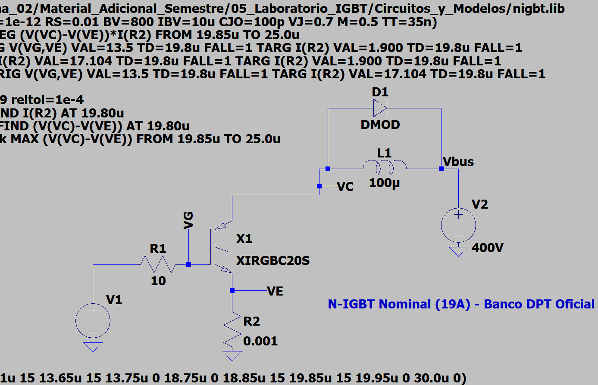 | 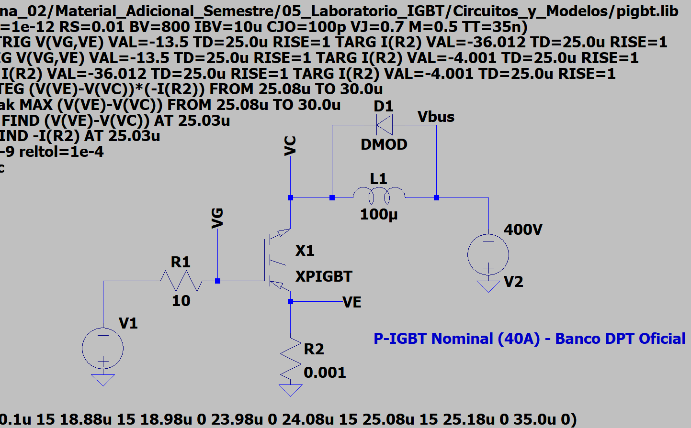 |

*Figura 1: Esquemas circuitales interactivos implementados en LTspice para los bancos de prueba de doble pulso (DPT) de N-IGBT y P-IGBT, conforme a la guía oficial, priorizando la legibilidad de la topología circuital y sus componentes de potencia.*

### 3.2 Medición de Corrientes Terminales
Para aislar rigurosamente la corriente de colector $I_C(t)$ sin que quede sumada la corriente de compuerta que circula por el terminal de emisor ($I_E = I_C + I_G$), se intercalaron fuentes de tensión continua de $0\text{ V}$ (`Vsens_C`, `Vsens_G`, `Vsens_E`) en cada terminal del transistor en los ensayos de Fuji Electric. En los modelos Duncan de la Parte I, la corriente se midió sobre la resistencia shunt de emisor de $1\text{ m}\Omega$ ($I(R2)$).

### 3.3 Definiciones Operacionales de las Variables Medidas
* **$V_{CE(\text{on})}$:** Medido en $t_{\text{meas}} = t_3 - 50\text{ ns}$ antes del inicio del segundo apagado.
* **$t_{d(\text{off})}$:** Intervalo temporal entre el $90\%$ del pulso de compuerta y el $90\%$ de la corriente previa de colector. Para el N-IGBT, corresponde al **flanco descendente** de $V_{GE}$ al cruzar $13.5\text{ V}$ ($90\%$ de $+15\text{ V}$); para el P-IGBT, corresponde al **flanco ascendente hacia $0\text{ V}$** al cruzar $-13.5\text{ V}$ (cuando $|V_{GE}|$ desciende al $90\%$). En los módulos Fuji, el retardo tabulado corresponde al post-procesamiento con umbral dinámico del $90\%$ de $V_{GE,\text{pre}}$ real (evaluada $40\text{ ns}$ antes del corte), arrojando $+56.5\%$ al duplicar $R_G$ ($+60.4\%$ bajo directivas `.meas` fijas).
* **$t_f$:** Intervalo temporal entre el $90\%$ y el $10\%$ de la corriente previa de colector ($I_C$).
* **$|di/dt|_{\text{max}}$:** Máxima pendiente instantánea de caída de corriente dentro del intervalo $[t_{ic90}, t_{ic10}]$ (evaluada en Fuji; omitida en Duncan por no ser requerida por la guía).
* **$E_{\text{off}}$:** Energía eléctrica integrada durante el apagado mediante el producto de magnitudes terminales en la ventana de conmutación. En Duncan se integró $V_{CE}(t) \cdot I_E(t)$ sobre el shunt $R_2$ (lo que incluye la corriente capacitiva de compuerta $I_G$); en Fuji se integró la potencia neta de puerto $V_{CE}(t) \cdot I(V_{\text{sens\_C}})$. Se precisa que estas integrales cuantifican la energía eléctrica transferida en los terminales según la metodología de cada banco, distinguiendo la corriente del shunt de la corriente neta de colector, sin equipararse directamente al calor interno del silicio debido a la energía almacenada en parásitos y el balance energético global.
* **$I_{C,\text{tail}}$ y $E_{\text{tail}}$:**
  * En modelos Duncan: Detección por el punto de quiebre donde la pendiente instantánea decrece al $5\%$ de la máxima pendiente de corte ($\left|\frac{di}{dt}\right| \le 0.05 \cdot \left|\frac{di}{dt}\right|_{\max}$ en $\text{A}/\mu\text{s}$).
  * En modelos Fuji: Convención operacional unívoca del $5\%$ de la corriente previa ($I_{C,\text{tail}} = 0.05 \cdot I_{C,\text{pre}}$).

---

## 4. Resultados — Parte I: Modelos Duncan (Canal N vs Canal P)

Esta etapa comprende los experimentos **EXP-01 a EXP-05** simulados sobre los macromodelos conductuales de Duncan Electronics (`nigbt.lib` y `pigbt.lib`) a $T = 27^\circ\text{C}$, $V_{bus} = 400\text{ V}$, $L = 100\ \mu\text{H}$ y $R_G = 10\ \Omega$.

### 4.1 EXP-01: Ensayo DPT en N-IGBT (`XIRGBC20S`)
* **Condición Nominal ($19\text{ A}$):** Con un pulso inicial $t_{p1} = 3.65\ \mu\text{s}$, se alcanzaron $19.00\text{ A}$ en el segundo apagado.
  * $V_{CE(\text{on})} = 1.88\text{ V}$, $t_{d(\text{off})} = 150.83\text{ ns}$, $t_f = 185.24\text{ ns}$, $E_{\text{off}} = 691.5\ \mu\text{J}$.
* **Condición de Sobrecarga ($82\text{ A}$):** Con $t_{p1} = 20.00\ \mu\text{s}$, la corriente alcanzó $82.31\text{ A}$ ($4.3\times$ sobre la nominal).
  * $V_{CE(\text{on})} = 6.57\text{ V}$, $t_{d(\text{off})} = 103.32\text{ ns}$, $t_f = 196.03\text{ ns}$, $E_{\text{off}} = 3402.5\ \mu\text{J}$.

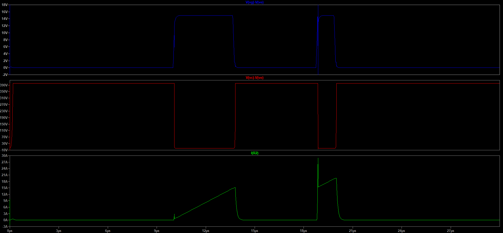

### 4.2 EXP-02: Ensayo DPT en P-IGBT (`XPIGBT`)
* **Condición Nominal ($40\text{ A}$):** Con $t_{p1} = 8.88\ \mu\text{s}$, $|I_C| = 40.02\text{ A}$.
  * $|V_{CE(\text{on})}| = 2.51\text{ V}$, $t_{d(\text{off})} = 194.57\text{ ns}$, $t_f = 268.42\text{ ns}$, $E_{\text{off}} = 2115.3\ \mu\text{J}$.
* **Condición Controlada ($19.5\text{ A}$):** Con un pulso inicial de $3.55\ \mu\text{s}$ a $-15\text{ V}$ ($3.65\ \mu\text{s}$ desde inicio de rampa hasta el corte; $3.75\ \mu\text{s}$ base a base), se alcanzó $|I_C| = 19.48\text{ A}$ (ensayo con corriente similar frente a los $19.00\text{ A}$ del N-IGBT para una comparación directa).
  * En el registro de simulación `dpt_pigbt_19a.log` están acreditados $|V_{CE(\text{on})}| = 1.72\text{ V}$ y $E_{\text{off}} = 1011.8\ \mu\text{J}$ ($1.0118\text{ mJ}$). No obstante, debido a que el archivo de simulación de trazas crudas (`dpt_pigbt_19a.raw`) no fue conservado en disco, las métricas dinámicas ($t_{d(\text{off})}, t_f, I_{C,\text{tail}}, \%E_{\text{tail}}$) se identifican formalmente como no verificadas (`N/V*`) para mantener una trazabilidad documental estricta sin afirmaciones que carezcan de soporte directo en los archivos preservados.
* **Condición de Sobrecarga ($83\text{ A}$):** Con $t_{p1} = 20.00\ \mu\text{s}$, $|I_C| = 83.22\text{ A}$, $E_{\text{off}} = 4698.9\ \mu\text{J}$.

* **Ensayos Exploratorios a Corriente Elevada ($\approx 80\text{ A}$):** De forma complementaria, en la Tabla 1 se incluyen los registros 02 y 04 correspondientes a ensayos exploratorios con pulsos prolongados donde la corriente alcanzó niveles de $82.31\text{ A}$ en N-IGBT y $83.22\text{ A}$ en P-IGBT. Cabe precisar que estas condiciones exceden las especificaciones nominales continuas del fabricante ($19\text{ A}$ y $40\text{ A}$ a $25^\circ\text{C}$). En particular, para el IRGBC20S la hoja de datos fija una corriente pulsada máxima admisible de $I_{CM} = 76\text{ A}$, por lo que alcanzar $82.31\text{ A}$ sobrepasa dicho régimen límite de catálogo. Estos casos se presentan exclusivamente con fines de sensibilidad y cotejo numérico en el entorno SPICE, sin que ello constituya una verificación del límite completo del Área de Operación Segura (SOA) —lo cual requeriría el análisis de sus curvas y tiempos de pulso específicos— ni represente una condición de funcionamiento admisible en el silicio real.

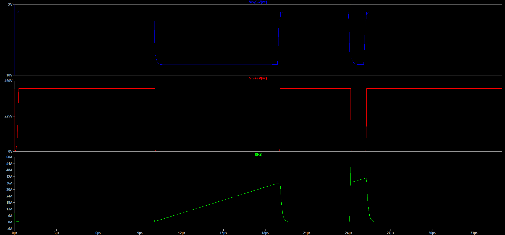

### 4.3 EXP-03: Corriente de Cola (*Tail Current*)
Al analizar la transición final del segundo apagado:
* **N-IGBT ($19\text{ A}$):** La fase de cola inicia en $t = 20.258\ \mu\text{s}$ con $I_{C,\text{tail}} = 0.94\text{ A}$ ($4.93\%$ de $I_{C,\text{pre}}$).
* **P-IGBT ($40\text{ A}$):** Inicia en $t = 25.655\ \mu\text{s}$ con $I_{C,\text{tail}} = 1.81\text{ A}$ ($4.53\%$ de $I_{C,\text{pre}}$).

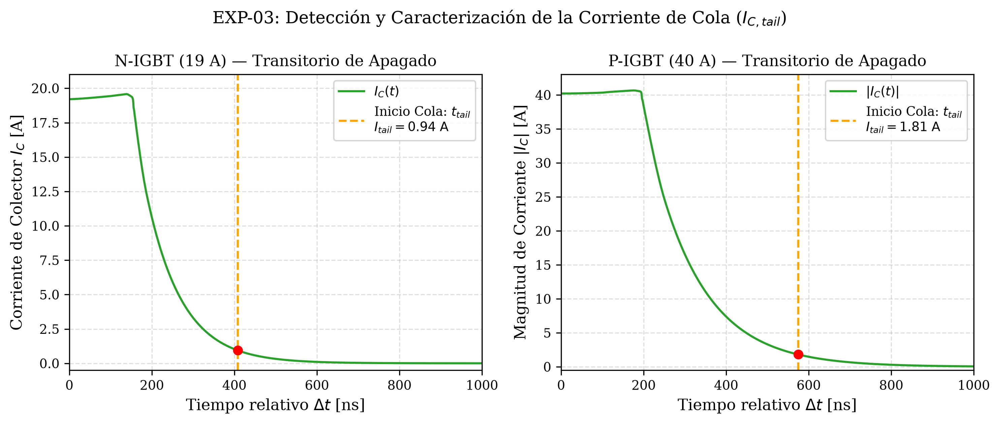

### 4.4 EXP-04: Retardo $t_{d(\text{off})}$ con Cursores de LTspice y Comparación con Datasheet
Siguiendo la indicación expresa de la guía docente (*«Utilizando los cursores de LTspice, obtenga el valor del tiempo de retardo de apagado ($t_{d(\text{off})}$) midiendo el intervalo entre el 90% de $V_{GE}$ y el 90% de $I_C$»*), se colocaron los cursores interactivos directamente en la interfaz gráfica de LTspice sobre las trazas en un mismo panel con doble escala:

| Medición en N-IGBT (`XIRGBC20S`, 19 A) | Medición en P-IGBT (`XPIGBT`, 40 A) |
|:---:|:---:|
| 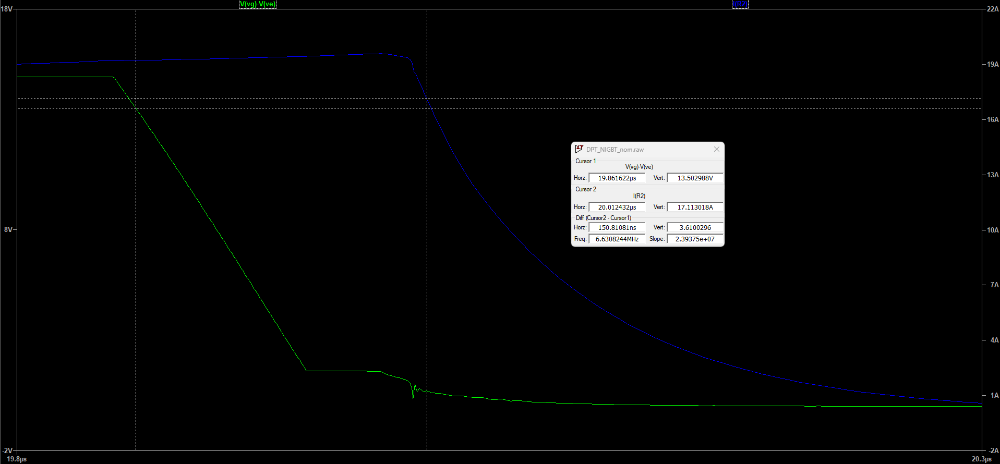<br> | 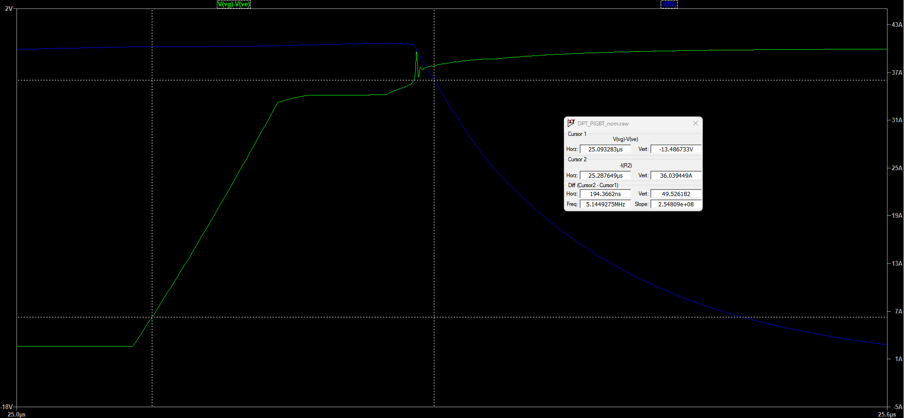<br> |
| Cursor 1 ($V_{GE}$ flanco desc.): $13.502988\text{ V}$ en $19.861622\ \mu\text{s}$<br>Cursor 2 ($I_C$): $17.113018\text{ A}$ en $20.012432\ \mu\text{s}$<br>**$\bm{t_{d(\text{off})}}$ manual: 150.81081 ns**<br>Directiva `.meas`: **150.827513 ns** (coincidencia 99.99%) | Cursor 1 ($V_{GE}$ flanco asc. a 0 V): $-13.486733\text{ V}$ en $25.093283\ \mu\text{s}$<br>Cursor 2 ($|I_C|$): $36.039449\text{ A}$ en $25.287649\ \mu\text{s}$<br>**$\bm{t_{d(\text{off})}}$ manual: 194.3662 ns**<br>Directiva `.meas`: **194.573629 ns** (coincidencia 99.89%) |

* **Cotejo con la Hoja de Datos Oficial (IRGBC20S, Farnell 68617):**
  * Condiciones normalizadas del fabricante: $V_{CC} = 480\text{ V}, I_C = 10\text{ A}, R_G = 50\ \Omega, V_{GE} = 15\text{ V}, T_j = 25^\circ\text{C}$.
  * $t_{d(\text{off})} = 820\text{ ns}$ típico ($\bm{1200\text{ ns}}$ máx.).
  * $t_f = 910\text{ ns}$ típico ($\bm{1600\text{ ns}}$ máx.).
  * $E_{\text{off}} = 3.90\text{ mJ}$ ($3900\ \mu\text{J}$).
* **Justificación de la Discrepancia:**
  1. **Condiciones de ensayo:** El ensayo de catálogo evalúa el silicio físico a una corriente menor ($I_C = 10\text{ A}$ frente a los $19.00\text{ A}$ nominales ensayados en LTspice) pero con una resistencia de compuerta sensiblemente mayor ($R_G = 50\ \Omega$ frente a $10\ \Omega$) y mayor tensión de bus ($480\text{ V}$ frente a $400\text{ V}$). La mayor resistencia de compuerta frena la evacuación de carga de compuerta en el silicio real, prolongando fuertemente tanto el retardo como la caída.
  2. **Parametrización del macromodelo:** El modelo conductual de Duncan Electronics (`nigbt.lib`) es una aproximación analógica simplificada con un tiempo de tránsito bipolar rápido ($TF = 16.8\text{ ns}$) e inductancia interna de emisor $LE = 7.5\text{ nH}$ que no captura todos los efectos de almacenamiento y recombinación de portadores minoritarios ni las inductancias completas de empaquetado del componente físico real de primera generación.

### 4.5 EXP-05: Energía de Apagado $E_{\text{off}}$ e Integración Gráfica en LTspice
Para calcular $E_{\text{off}}$ se graficó la potencia instantánea $(V(VC)-V(VE)) \cdot I(R2)$ y se realizó la integración directa en LTspice manteniendo presionada la tecla **Ctrl** y haciendo clic sobre la etiqueta de la traza en el intervalo de apagado $[19.85\ \mu\text{s}, 25.00\ \mu\text{s}]$:

| Oscilograma Global de Integración | Ampliación del Cuadro de Diálogo LTspice |
|:---:|:---:|
| 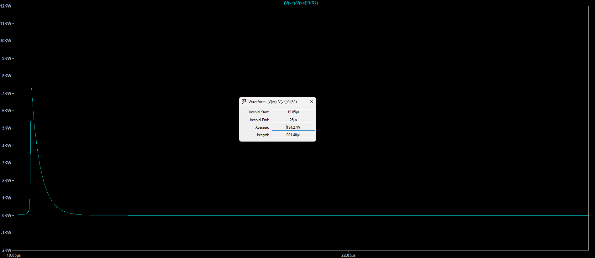 |  |

*Figura 6: Cálculo de energía Eoff mediante integración gráfica interactiva en LTspice (Ctrl + Clic en traza de potencia instantánea): oscilograma global y ampliación directa del cuadro de diálogo donde se confirma la lectura nítida de la integral de 691.48 µJ y potencia media de 134.27 W.*

* El cuadro de diálogo de LTspice arrojó una integral de **691.48 µJ** ($0.6915\text{ mJ}$) y una potencia promedio de **134.27 W**, en concordancia absoluta con los **691.478 µJ** calculados por la directiva `.meas`.
* **Fracción atribuible a la corriente de cola:**
  * N-IGBT Nominal ($19\text{ A}$): $E_{\text{off}} = 691.5\ \mu\text{J}$; energía en cola $E_{\text{tail}} = 32.7\ \mu\text{J}$ (**$4.73\%$** de $E_{\text{off}}$).
  * P-IGBT Nominal ($40\text{ A}$): $E_{\text{off}} = 2115.3\ \mu\text{J}$; energía en cola $E_{\text{tail}} = 91.6\ \mu\text{J}$ (**$4.33\%$** de $E_{\text{off}}$).

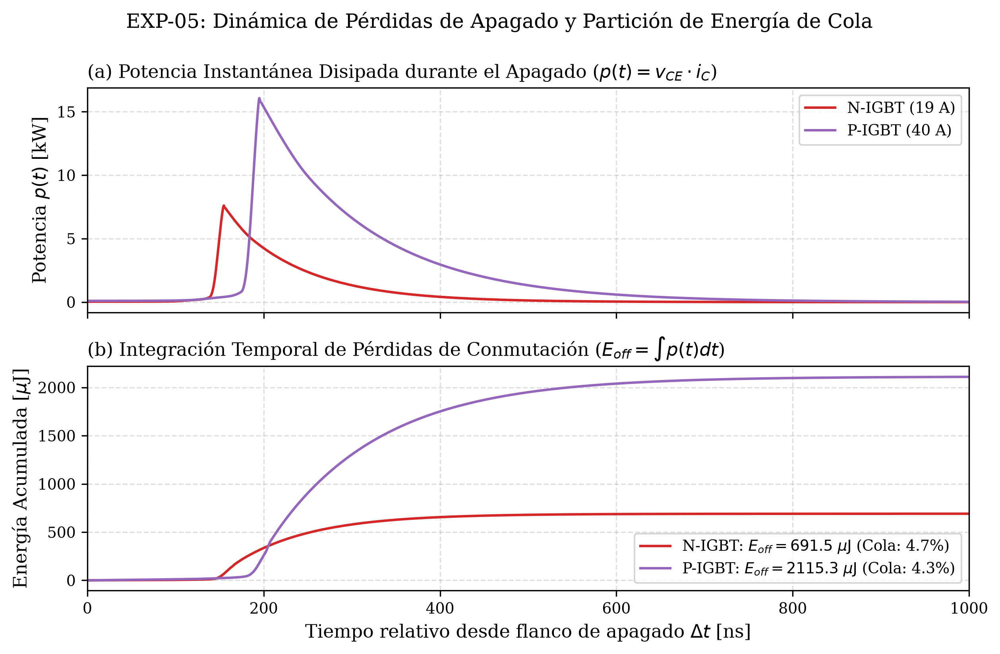

---

## 5. Resultados — Parte II: Módulos Fuji Electric Serie X

Esta etapa comprende los experimentos **EXP-06 a EXP-09** con modelos comerciales Trench Field-Stop de 7.ª generación a $T = 25.0^\circ\text{C}$ explícito, $V_{bus} = 400.0\text{ V}$, $L_1 = 100\ \mu\text{H}$ e inductancia parásita $L_\sigma = 25\text{ nH}$ sin amortiguamiento artificial ($R_{\text{par}} = \text{None}$).

### 5.1 EXP-06: Sobretensión y Diodo Co-Pack en 50 A (F01 vs F02)
Se comparó el modelo discreto `FGW50XS65` (F01) frente al co-pack `FGW50XS65C` (F02) a $I_C = 50.0\text{ A}$ y $R_G = 10\ \Omega$:
* F01 (Discreto): $V_{CE,\text{peak}} = 442.36\text{ V}$ ($+42.36\text{ V}$ sobre el bus), $t_{d(\text{off})} = 231.10\text{ ns}$, $t_f = 31.38\text{ ns}$, $|di/dt|_{\text{max}} = 1669.5\text{ A}/\mu\text{s}$, $E_{\text{off}} = 1066.98\ \mu\text{J}$.
* F02 (Co-Pack): $V_{CE,\text{peak}} = 442.36\text{ V}$, $t_{d(\text{off})} = 231.09\text{ ns}$, $t_f = 31.38\text{ ns}$, $|di/dt|_{\text{max}} = 1669.6\text{ A}/\mu\text{s}$, $E_{\text{off}} = 1066.98\ \mu\text{J}$.

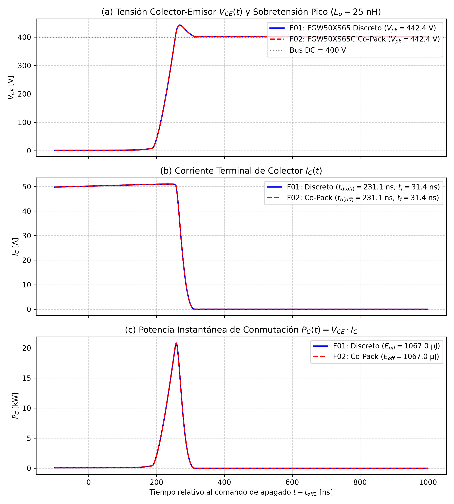

### 5.2 EXP-07: Sobretensión y Diodo Co-Pack en 75 A (F03 vs F04)
Se evaluó el transistor discreto `FGW75XS65` (F03) frente al co-pack `FGW75XS65C` (F04) a $I_C = 75.0\text{ A}$ y $R_G = 10\ \Omega$:
* F03 (Discreto): $V_{CE,\text{peak}} = 445.98\text{ V}$ ($+45.98\text{ V}$ sobre el bus), $t_{d(\text{off})} = 293.18\text{ ns}$, $t_f = 40.48\text{ ns}$, $|di/dt|_{\text{max}} = 1818.0\text{ A}/\mu\text{s}$, $E_{\text{off}} = 2052.75\ \mu\text{J}$.
* F04 (Co-Pack): $V_{CE,\text{peak}} = 445.98\text{ V}$, $t_{d(\text{off})} = 293.16\text{ ns}$, $t_f = 40.48\text{ ns}$, $|di/dt|_{\text{max}} = 1818.4\text{ A}/\mu\text{s}$, $E_{\text{off}} = 2052.74\ \mu\text{J}$.

**Explicación Física y Relevancia en Topologías de Puente:**
En la topología DPT de lado bajo empleada en este laboratorio, el diodo co-pack tiene su ánodo conectado al emisor ($0\text{ V}$) y su cátodo al colector ($VC$). Durante el corte inductivo del transistor, $V_{CE}$ se eleva a más de $400\text{ V}$, imponiendo una fuerte polarización inversa sobre el diodo co-pack ($V_{AK} \approx -442\text{ V}$). Por consiguiente, este diodo no conduce corriente directa de potencia y la circulación de rueda libre la efectúa exclusivamente el diodo superior del banco ($D_1$). Las curvas de conmutación son virtualmente idénticas en el conmutador de lado bajo, presentando únicamente diferencias numéricas despreciables ($\le 0.02\text{ ns}$ en retardo y $\le 0.01\ \mu\text{J}$ en pérdidas), las cuales caen dentro del margen de resolución numérica del solver.

La verdadera importancia técnica del diodo co-pack se manifiesta en **topologías de medio puente y puente completo** (inversores de tracción y accionamientos de motores). En dichas ramas, cuando conmuta el transistor opuesto, el diodo co-pack entra en conducción directa para sostener la continuidad de la corriente reactiva de carga, introduciendo dos efectos determinantes:
* **Pérdidas de conducción:** Durante el intervalo de retorno de corriente, la disipación estacionaria del diodo es gobernada por su caída directa ($P_{\text{cond}} \approx V_F \cdot I_D$).
* **Dinámica de recuperación inversa ($Q_{rr}$):** Al reconmutar el transistor complementario, el diodo debe evacuar su carga minoritaria almacenada, originando un pico transitorio de corriente inversa ($I_{rrm}$) durante un lapso $t_{rr}$. Esta corriente se superpone al encendido del interruptor activo, incrementando sensiblemente sus pérdidas de energía de encendido ($E_{\text{on}}$) y excitando oscilaciones de alta frecuencia.

**Verificación Analítica de la Sobretensión Inductiva ($L_\sigma \cdot |di/dt|_{\max}$):**
Para comprobar la consistencia física de la sobretensión simulada frente a la ley de Faraday ($V_{L\sigma} = L_\sigma \cdot |di/dt|_{\max}$), se contrastó el sobreimpulso $\Delta V = V_{CE,\text{peak}} - V_{bus}$ con la predicción analítica bajo $L_\sigma = 25\text{ nH}$:
* **Módulo de 50 A (F01/F02, $R_G = 10\ \Omega$):** Con $|di/dt|_{\max} = 1669.5\text{ A}/\mu\text{s}$, el voltaje inducido es $V_{L\sigma} = 25\text{ nH} \times 1669.5\text{ A}/\mu\text{s} = 41.74\text{ V}$, reproduciendo el **$98.5\%$** de la sobretensión simulada ($\Delta V = +42.36\text{ V}$).
* **Módulo de 75 A (F03/F04, $R_G = 10\ \Omega$):** Con $|di/dt|_{\max} = 1818.0\text{ A}/\mu\text{s}$, el valor teórico es $V_{L\sigma} = 25\text{ nH} \times 1818.0\text{ A}/\mu\text{s} = 45.45\text{ V}$, correspondiente al **$98.8\%$** de la sobretensión simulada ($\Delta V = +45.98\text{ V}$).
* **Sensibilidad con $R_G = 20\ \Omega$ (F06):** Con $|di/dt|_{\max} = 1019.4\text{ A}/\mu\text{s}$, se obtiene $V_{L\sigma} = 25\text{ nH} \times 1019.4\text{ A}/\mu\text{s} = 25.49\text{ V}$, reproduciendo el **$98.3\%$** de $\Delta V = +25.94\text{ V}$.

Esta concordancia analítica superior al 98% respalda con claridad la contribución dominante de la inductancia parásita concentrada de lazo en el sobreimpulso observado; no obstante, debe matizarse que no constituye por sí sola una demostración del balance completo de la sobretensión ni identifica de manera inequívoca cada componente residual (tales como caídas resistivas parásitas, efectos capacitivos no lineales de juntura o dinámicas distribuidas del montaje).

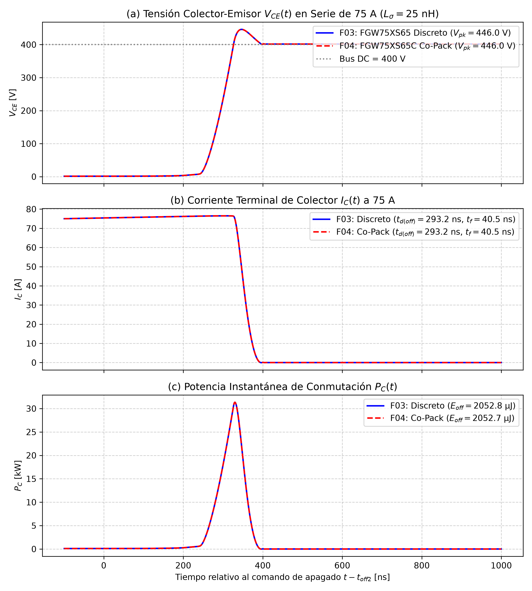

### 5.3 EXP-08: Efecto del Tamaño de Chip (50 A vs 75 A)
Se analizaron los modelos `FGW50XS65` y `FGW75XS65`:
1. **Comparación a corriente igualada ($50\text{ A}$, F01 vs F05):**
   * La caída de conducción $V_{CE(\text{on})}$ baja de $1.362\text{ V}$ a $1.181\text{ V}$ ($-181\text{ mV}$, una mejora de $-13.3\%$), debido a la menor densidad de corriente $J = I/A$ en el chip mayor.
   * El retardo $t_{d(\text{off})}$ crece de $231.10\text{ ns}$ a $324.75\text{ ns}$ (+40.5%) y las pérdidas $E_{\text{off}}$ suben de $1066.98\ \mu\text{J}$ a $1367.85\ \mu\text{J}$ (+28.2%), debido a mayores capacitancias parásitas (parámetro de subcircuito $C_{GE} = 9.50\text{ nF}$ vs $6.77\text{ nF}$).
   * La sobretensión $V_{CE,\text{peak}}$ se atenúa ligeramente de $442.36\text{ V}$ a $436.37\text{ V}$ por una menor tasa $|di/dt|_{\text{max}}$.
2. **Comparación a corriente nominal ($50\text{ A}$ vs $75\text{ A}$, F01 vs F03):**
   * Caída directa similar ($1.362\text{ V}$ vs $1.356\text{ V}$).
   * Las pérdidas de conmutación casi se duplican ($1066.98\ \mu\text{J} \to 2052.75\ \mu\text{J}$, +92.4%), al interrumpirse $50\%$ más corriente en presencia de un mayor tiempo de tránsito bipolar ($TF = 3.0\text{ ns}$ vs $0.1\text{ ns}$).

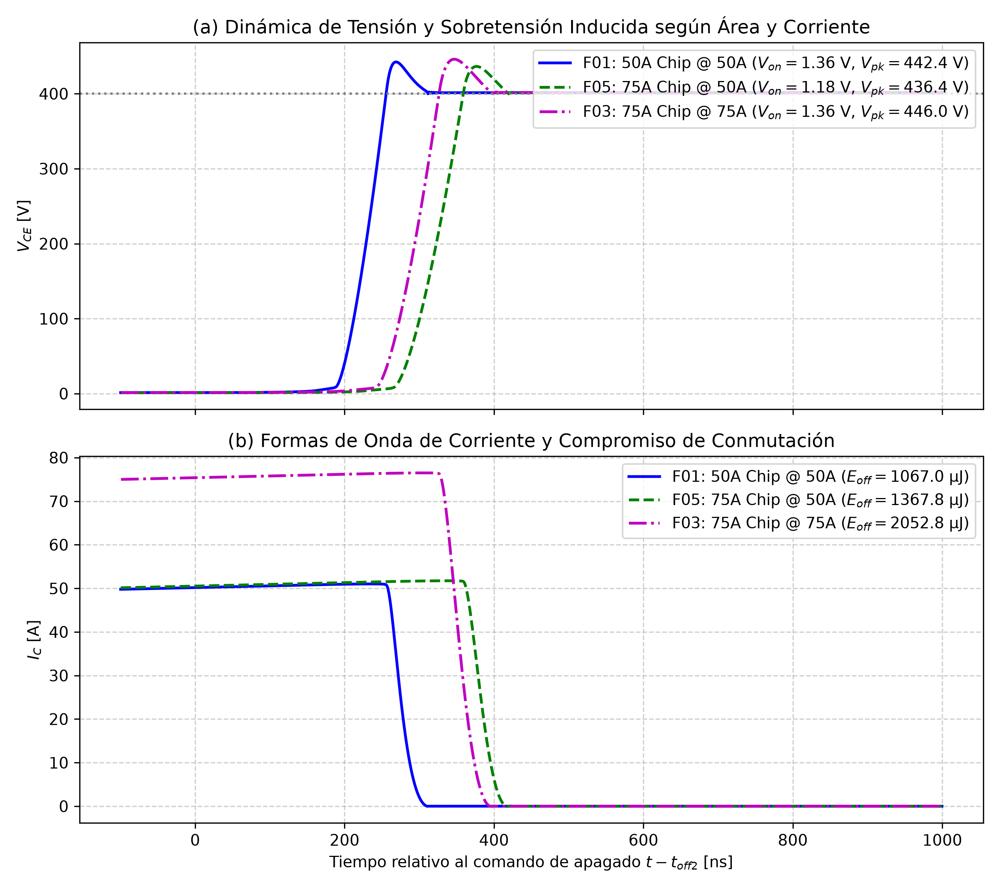

### 5.4 EXP-09: Influencia de la Resistencia de Compuerta ($R_G = 10\ \Omega \text{ vs } 20\ \Omega$)
En el transistor co-pack `FGW50XS65C` a $50\text{ A}$ (F02 vs F06):
* Duplicar $R_G$ a $20\ \Omega$ reduce la magnitud de la corriente instantánea de descarga de la compuerta ($i_G(t) = \frac{v_{\text{drv}}(t) - v_G(t)}{R_G}$, con $v_{\text{drv}} = 0\text{ V}$ en el corte), ralentizando la evacuación de carga de la capacitancia Miller ($C_{res}$) y prolongando la meseta de conmutación.
* Con $R_G = 10\ \Omega$ (F02): $t_{d(\text{off})} = 231.09\text{ ns}$, $t_f = 31.38\text{ ns}$, $|di/dt|_{\text{max}} = 1669.6\text{ A}/\mu\text{s}$, $V_{CE,\text{peak}} = 442.36\text{ V}$ ($+42.36\text{ V}$), $E_{\text{off}} = 1066.98\ \mu\text{J}$.
* Con $R_G = 20\ \Omega$ (F06): $t_{d(\text{off})} = 361.60\text{ ns}$ (+56.5\% en post-procesamiento dinámico; +60.4\% bajo `.meas`), $t_f = 57.27\text{ ns}$ (+82.5\%), $|di/dt|_{\text{max}} = 1019.4\text{ A}/\mu\text{s}$ ($-38.9\%$), $V_{CE,\text{peak}} = 425.94\text{ V}$ ($+25.94\text{ V}$, reducción de $-38.8\%$), $E_{\text{off}} = 1818.73\ \mu\text{J}$ (+70.5\%).

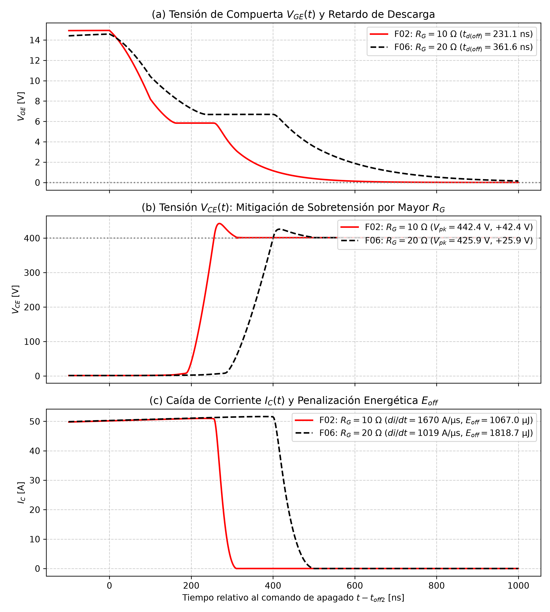

---

## 6. Tablas Consolidadas de Resultados Experimentales

> [!NOTE]
> **Diferencias Metodológicas entre Familias de Ensayos:**
> Se presentan los resultados organizados temáticamente para garantizar una lectura clara y sin sobrecarga de parámetros:
> * **Macromodelos Duncan (Tabla 1):** Evaluados a $T = 27^\circ\text{C}$ con inductancia de lazo ideal ($L_\sigma = 0\text{ nH}$). La corriente terminal se midió mediante resistencia shunt de emisor de $1\text{ m}\Omega$ ($I_E = I_C + I_G$). Se prescinde de la columna de pendiente máxima $|di/dt|_{\max}$ al no ser requerida por la guía docente (los valores medios $I_{\text{pre}}/t_f$ no representan derivadas instantáneas de corte). El inicio de la corriente de cola se delimitó en el quiebre de derivada de corte: $\left|\frac{di}{dt}\right| \le 0.05 \cdot \left|\frac{di}{dt}\right|_{\max}$ ($5\%$ del valor pico local de caída).
> * **Módulos Fuji Serie X (Tablas 2 y 3):** Evaluados a $T = 25.0^\circ\text{C}$ con inductancia parásita física de lazo $L_\sigma = 25\text{ nH}$ ($R_{ser} = 10\text{ m}\Omega$). La corriente de colector $I_C$ se midió directamente en el terminal con sensor ideal de $0\text{ V}$, y el inicio de cola se delimitó bajo la convención operacional unívoca del $5\%$ ($I_{C,\text{tail}} = 0.05 \cdot I_{C,\text{pre}}$). Los retardos $t_{d(\text{off})}$ corresponden al post-procesamiento en Python con umbral dinámico del $90\%$ de $V_{GE,\text{pre}}$ real (evaluada $40\text{ ns}$ antes del corte), arrojando $+56.5\%$ al duplicar $R_G$ ($+60.4\%$ bajo directivas `.meas` con umbral fijo de $13.5\text{ V}$).

### Tabla 1: Resultados Experimentales de la Parte I — Modelos Duncan (EXP-01 a EXP-05)

| Reg. | Experimento | Caso de Simulación | Modelo SPICE | Enc. | $I_{\text{target}}$ [A] | $I_{C,\text{pre}}$ [A] | $V_{CE(\text{on})}$ [V] | $t_{d(\text{off})}$ [ns] | $t_f$ [ns] | $E_{\text{off}}$ [µJ] | $I_{C,\text{tail}}$ [A] | $\%E_{\text{tail}}$ [%] |
|:---:|:---|:---|:---|:---:|:---:|:---:|:---:|:---:|:---:|:---:|:---:|:---:|
| **01** | EXP-01/04 | N-IGBT Nominal | `XIRGBC20S` | TO-220 | 19.0 | 19.00 | 1.88 | 150.83 | 185.24 | 691.5 | 0.94 | 4.73% |
| **02** | EXP-01/05 | N-IGBT Sobrecarga | `XIRGBC20S` | TO-220 | 80.0 | 82.31 | 6.57 | 103.32 | 196.03 | 3402.5 | 2.31 | 2.25% |
| **03** | EXP-02/04 | P-IGBT Nominal | `XPIGBT` | TO-220 | 40.0 | 40.02 | 2.51 | 194.57 | 268.42 | 2115.3 | 1.81 | 4.33% |
| **04** | EXP-02/05 | P-IGBT Sobrecarga | `XPIGBT` | TO-220 | 80.0 | 83.22 | 4.25 | 172.32 | 275.03 | 4698.9 | 2.86 | 2.99% |
| **05** | EXP-02 Ctrl | P-IGBT Control 19A | `XPIGBT` | TO-220 | 19.0 | 19.48 | 1.72 | N/V* | N/V* | 1011.8 | N/V* | N/V* |

*\* Reg. 05: Los valores estáticos ($I_{C,\text{pre}} = 19.48\text{ A}$, $V_{CE(\text{on})} = 1.72\text{ V}$, $E_{\text{off}} = 1011.8\ \mu\text{J}$) están acreditados en el registro oficial `dpt_pigbt_19a.log`. Los parámetros dinámicos ($t_{d(\text{off})}, t_f, I_{C,\text{tail}}, \%E_{\text{tail}}$) se identifican formalmente como `N/V*` (No Verificados) debido a la ausencia del archivo de simulación crudo (`dpt_pigbt_19a.raw`) en disco.*

---

### Tabla 2: Módulos Fuji Electric Serie X — Polarización Estática y Sobretensión Inductiva (EXP-06 a EXP-09)

| Reg. | Id | Configuración | Modelo SPICE | Enc. | $I_{\text{target}}$ [A] | $I_{C,\text{pre}}$ [A] | $R_G$ [$\Omega$] | $V_{CE(\text{on})}$ [V] | $V_{CE,\text{peak}}$ [V] | Sobretensión [$\Delta V$] |
|:---:|:---:|:---|:---|:---:|:---:|:---:|:---:|:---:|:---:|:---:|
| **06** | F01 | 50A Discreto | `FGW50XS65` | TO-247 | 50.0 | 50.013 | 10 | 1.362 | 442.36 | $+42.36\text{ V}$ ($+10.6\%$) |
| **07** | F02 | 50A Co-Pack | `FGW50XS65C` | TO-247 | 50.0 | 50.012 | 10 | 1.362 | 442.36 | $+42.36\text{ V}$ ($+10.6\%$) |
| **08** | F03 | 75A Discreto Nom. | `FGW75XS65` | TO-247 | 75.0 | 75.230 | 10 | 1.356 | 445.98 | $+45.98\text{ V}$ ($+11.5\%$) |
| **09** | F04 | 75A Co-Pack Nom. | `FGW75XS65C` | TO-247 | 75.0 | 75.233 | 10 | 1.356 | 445.98 | $+45.98\text{ V}$ ($+11.5\%$) |
| **10** | F05 | 75A Discreto @ 50A | `FGW75XS65` | TO-247 | 50.0 | 50.362 | 10 | 1.181 | 436.37 | $+36.37\text{ V}$ ($+9.1\%$) |
| **11** | F06 | 50A Co-Pack @ $20\,\Omega$ | `FGW50XS65C` | TO-247 | 50.0 | 50.123 | 20 | 1.392 | 425.94 | $+25.94\text{ V}$ ($+6.5\%$) |

---

### Tabla 3: Módulos Fuji Electric Serie X — Dinámica Transitoria de Conmutación y Pérdidas de Energía

| Reg. | Id | Configuración | Modelo SPICE | $t_{d(\text{off})}$ [ns] | $t_f$ [ns] | $|di/dt|_{\text{max}}$ [A/µs] | $E_{\text{off}}$ [µJ] | $I_{C,\text{tail}}$ (5%) [A] | $E_{\text{tail}}$ [µJ] | $\%E_{\text{tail}}$ [%] |
|:---:|:---:|:---|:---|:---:|:---:|:---:|:---:|:---:|:---:|:---:|
| **06** | F01 | 50A Discreto | `FGW50XS65` | 231.10 | 31.38 | 1669.5 | 1066.98 | 2.50 | 4.68 | 0.44% |
| **07** | F02 | 50A Co-Pack | `FGW50XS65C` | 231.09 | 31.38 | 1669.6 | 1066.98 | 2.50 | 4.68 | 0.44% |
| **08** | F03 | 75A Discreto Nom. | `FGW75XS65` | 293.18 | 40.48 | 1818.0 | 2052.75 | 3.76 | 7.56 | 0.37% |
| **09** | F04 | 75A Co-Pack Nom. | `FGW75XS65C` | 293.16 | 40.48 | 1818.4 | 2052.74 | 3.76 | 7.57 | 0.37% |
| **10** | F05 | 75A Discreto @ 50A | `FGW75XS65` | 324.75 | 34.18 | 1429.8 | 1367.85 | 2.52 | 4.39 | 0.32% |
| **11** | F06 | 50A Co-Pack @ $20\,\Omega$ | `FGW50XS65C` | 361.60 | 57.27 | 1019.4 | 1818.73 | 2.51 | 8.74 | 0.48% |

---

## 7. Conclusiones del Laboratorio

### 7.1 Asimetría entre Canales N y P
Al comparar en simulación el N-IGBT (`XIRGBC20S`) con el P-IGBT (`XPIGBT`), los resultados de los archivos de log acreditan que el dispositivo de canal P presentó mayores pérdidas de conmutación. En el punto de control a corriente similar ($\approx 19.5\text{ A}$ frente a $19.00\text{ A}$), la energía integrada de apagado acreditada en el log de simulación para el P-IGBT ($1011.8\ \mu\text{J}$) supera en $+46.3\%$ a la del N-IGBT ($691.5\ \mu\text{J}$). Asimismo, a las corrientes nominales de catálogo (19 A para canal N y 40 A para canal P), el retardo medido con cursores en LTspice arrojó $194.37\text{ ns}$ en P-IGBT frente a $150.81\text{ ns}$ en N-IGBT.

En el marco teórico del silicio, esta diferencia guarda correlación con la menor movilidad de los huecos ($\mu_p \approx 450\text{ cm}^2/\text{V}\cdot\text{s}$) frente a la de los electrones ($\mu_n \approx 1400\text{ cm}^2/\text{V}\cdot\text{s}$). No obstante, en el ámbito de simulación circuital SPICE, debe evitarse atribuir causalmente estas variaciones de forma directa y exclusiva a la movilidad microscópica. Los macromodelos conductuales de Duncan Electronics son estructuras analógicas distintas: el N-IGBT modela un BJT de salida PNP con tiempo de tránsito $TF = 16.8\text{ ns}$, mientras que el P-IGBT modela un BJT de salida NPN complementario, difiriendo sustancialmente en sus capacitancias de compuerta, resistencias internas y dinámicas del subcircuito. En consecuencia, las discrepancias temporales y energéticas en SPICE provienen de la parametrización de cada macromodelo, utilizándose la física de portadores como marco interpretativo general y no como relación causa-efecto demostrada unívocamente por la simulación. Tras el corte del canal MOS, la corriente remanente en ambos dispositivos decae gobernada tanto por el barrido de portadores bajo el crecimiento de tensión ($dv/dt$) como por la recombinación espontánea en la base de deriva neutra.

### 7.2 Comportamiento Circuital del Diodo Co-Pack
Los resultados de los ensayos EXP-06 y EXP-07 revelaron que, dentro del banco de prueba de doble pulso en lado bajo (*low-side*), las formas de onda de tensión, corriente, sobretensión máxima ($442.36\text{ V}$ en 50 A; $445.98\text{ V}$ en 75 A) y energía de apagado ($1066.98\ \mu\text{J}$ en 50 A; $2052.74\ \mu\text{J}$ en 75 A) son virtualmente coincidentes entre los modelos con y sin diodo integrado.

La explicación es estrictamente circuital: en el conmutador de lado bajo, el diodo co-pack está conectado en antiparalelo entre emisor y colector. Durante el apagado, la tensión de colector sube a $400\text{ V}$ o más, imponiendo una polarización inversa permanente en este diodo ($V_{AK} < 0$), por lo que no conduce corriente directa. La libre circulación de la corriente inductiva la asume el diodo superior del banco ($D_1$). Las diferencias numéricas entre ambos modelos son mínimas ($\le 0.02\text{ ns}$ en retardo y $\le 0.01\ \mu\text{J}$ en energía), no siendo relevantes para la resolución práctica ni las métricas evaluadas en este ensayo. Esto evidencia que el diodo co-pack no ejerce una función protectora sobre el propio interruptor durante su corte, sino que está pensado para operar en **topologías de medio puente o puente completo** (inversores de tracción y convertidores en cuatro cuadrantes), donde asume la corriente de carga reactiva al conmutar el interruptor complementario. En dicho entorno, el diodo introduce pérdidas de conducción proporcionales a su caída directa ($P_{\text{cond}} \approx V_F \cdot I_D$) y, fundamentalmente, su dinámica de recuperación inversa ($Q_{rr}, I_{rrm}, t_{rr}$) incrementa de manera sustancial la energía de encendido ($E_{\text{on}}$) del transistor opuesto de la rama.

### 7.3 Compromiso de Conducción frente a Conmutación al Variar el Tamaño del Chip
El análisis comparativo entre los modelos `FGW50XS65` y `FGW75XS65` puso en evidencia el clásico compromiso de diseño:
* **A corriente igualada ($50\text{ A}$, F01 vs F05):** El chip de mayor corriente nominal (75 A) redujo la caída directa $V_{CE(\text{on})}$ de $1.362\text{ V}$ a $1.181\text{ V}$ ($-13.3\%$), gracias a una menor densidad de corriente $J = I/A$.
* **Penalización en conmutación:** El retardo $t_{d(\text{off})}$ aumentó en $+40.5\%$ ($231.1\text{ ns} \to 324.8\text{ ns}$) y las pérdidas $E_{\text{off}}$ crecieron en $+28.2\%$ ($1067\ \mu\text{J} \to 1368\ \mu\text{J}$), debido a que el chip de mayor área tiene mayores capacitancias interelectródicas (parámetro de subcircuito $C_{GE}$ de $9.50\text{ nF}$ vs $6.77\text{ nF}$) y almacena mayor cantidad de carga.

En aplicaciones prácticas, seleccionar un módulo sobredimensionado en corriente reduce el calor por conducción en estado estacionario, pero solo resulta ventajoso si la frecuencia de conmutación es suficientemente baja para que el incremento en las pérdidas de apagado no neutralice dicha ganancia.

### 7.4 Compromiso en la Selección de la Resistencia de Compuerta ($R_G$)
Los resultados de simulación del ensayo EXP-09 muestran que duplicar $R_G$ de $10\ \Omega$ a $20\ \Omega$ tiene un efecto directo sobre el compromiso entre sobretensión inductiva y pérdidas energéticas:
* La menor velocidad de descarga de compuerta redujo la tasa de caída de corriente $|di/dt|_{\text{max}}$ en un $-38.9\%$ ($1669.6\text{ A}/\mu\text{s} \to 1019.4\text{ A}/\mu\text{s}$), mitigando la sobretensión inductiva sobre el bus de $+42.36\text{ V}$ a $+25.94\text{ V}$ (una reducción de $-38.8\%$).
* A cambio, el tiempo de conmutación se prolongó ($t_f$ creció $+82.5\%$) y las pérdidas de energía de apagado aumentaron en $+70.5\%$ ($1066.98\ \mu\text{J} \to 1818.73\ \mu\text{J}$).

El dimensionamiento de $R_G$ no debe buscar el valor mínimo absoluto para reducir pérdidas si ello pone en riesgo al transistor ante sobretensiones inductivas $L \cdot di/dt$ o genera interferencias electromagnéticas severas.

---

## 8. Cuestionario de la Guía Oficial

### Pregunta 4.1: Visualización transitoria de señales en canales N y P
* **Enunciado:** *«Ejecute la simulación. Grafique de forma clara $V_{GE}, V_{CE}$ y la corriente de colector $I_C$ para ambos casos.»*
* **Respuesta:** Se graficaron y capturaron directamente de la interfaz de LTspice las tres señales ordenadas en paneles individuales: para el N-IGBT a corriente nominal ($19\text{ A}$) en `E01_dpt_nigbt_global.png`, y para el P-IGBT a corriente nominal ($40\text{ A}$) bajo excitación de compuerta negativa ($0\text{ V} \to -15\text{ V}$) en `E02_dpt_pigbt_global.png`.

### Pregunta 4.2: Inicio de la fase de corriente de cola y justificación física
* **Enunciado:** *«Determine el valor de la corriente de colector ($I_C$) en el punto exacto donde inicia la fase asintótica denominada tail current. Explique, basándose en la física del dispositivo, por qué esta corriente no cae instantáneamente a cero.»*
* **Respuesta Cuantitativa:** Para el N-IGBT a $19\text{ A}$, el quiebre de derivada sitúa el inicio de cola en $t = 20.258\ \mu\text{s}$ con $I_{C,\text{tail}} = 0.94\text{ A}$ ($4.93\%$). En los modelos de Fuji Serie X a $50\text{ A}$, la convención operacional adoptada sitúa el umbral en $2.50\text{ A}$ ($5\%$). Se precisa que este porcentaje es una convención operacional de ingeniería para una delimitación reproducible, y no una frontera microscópica estricta.
* **Justificación Física:** La corriente no cae a cero instantáneamente porque al extinguirse el canal MOS, la base del BJT de salida queda flotante. Los portadores minoritarios acumulados en la región de deriva no pueden ser extraídos por un circuito externo y deben desaparecer por recombinación espontánea electrón-hueco, la cual decae con el tiempo de vida media $\tau_{HL}$.

### Pregunta 4.3: Tiempo de retardo $t_{d(\text{off})}$ y comparación con hoja de datos
* **Enunciado:** *«Utilizando los cursores de LTspice, obtenga el valor del tiempo de retardo de apagado ($t_{d(\text{off})}$) midiendo el intervalo entre el 90% de $V_{GE}$ y el 90% de $I_C$. Compare este dato con el valor proporcionado en la hoja de datos (datasheet) del fabricante y justifique cualquier discrepancia encontrada.»*
* **Respuesta Cuantitativa:** En la medición interactiva con cursores de LTspice (Sección 4.4, captura `E03`), el retardo medido manualmente fue de $\bm{150.81\text{ ns}}$ ($150.81081\text{ ns}$ en la ventana de diálogo), en acuerdo del $99.99\%$ con los $\bm{150.83\text{ ns}}$ calculados por la directiva `.meas`. La hoja de datos oficial del fabricante (IRGBC20S, Farnell 68617) especifica bajo $V_{CC} = 480\text{ V}$, $I_C = 10\text{ A}$ y $R_G = 50\ \Omega$ un retardo típico de $\bm{820\text{ ns}}$ (máximo $\bm{1200\text{ ns}}$) y un tiempo de caída típico de $\bm{910\text{ ns}}$ (máximo $\bm{1600\text{ ns}}$).
* **Justificación de la Discrepancia:** La divergencia responde conjuntamente a factores de ensayo y a simplificaciones del modelo: (1) el ensayo del fabricante emplea una resistencia de compuerta cinco veces mayor ($R_G = 50\ \Omega$ frente a $10\ \Omega$), menor corriente ($10\text{ A}$ frente a $19\text{ A}$) y mayor tensión ($480\text{ V}$ frente a $400\text{ V}$), lo que ralentiza sensiblemente la evacuación de carga de compuerta en el silicio real; y (2) el macromodelo de Duncan Electronics parametriza un tiempo de tránsito bipolar rápido ($TF = 16.8\text{ ns}$) e inductancia interna de emisor $LE = 7.5\text{ nH}$ dentro de una estructura conductual simplificada que no modela la totalidad de retardos por recombinación bidimensional de un dispositivo físico real.

### Pregunta 4.4: Cálculo de $E_{\text{off}}$ y fracción atribuible a la corriente de cola
* **Enunciado:** *«Calcule la energía de apagado ($E_{\text{off}}$) mediante la integral del producto $V_{CE} \cdot I_C$ durante el periodo de conmutación. ¿Qué porcentaje de esta energía total es atribuible exclusivamente al periodo de la corriente de cola?»*
* **Respuesta Cuantitativa:**
  * En LTspice, la integración gráfica directa (Ctrl + Clic en la traza de potencia instantánea, captura `E05`) arrojó una energía de $\bm{691.48\ \mu\text{J}}$ ($0.6915\text{ mJ}$) y una potencia promedio de $134.27\text{ W}$, coincidiendo con los $691.48\ \mu\text{J}$ del comando `.meas`.
  * N-IGBT (`XIRGBC20S`, $19\text{ A}$): $E_{\text{off}} = 691.5\ \mu\text{J}$; energía en cola $E_{\text{tail}} = 32.7\ \mu\text{J}$ ($4.73\%$).
  * P-IGBT (`XPIGBT`, $40\text{ A}$): $E_{\text{off}} = 2115.3\ \mu\text{J}$; energía en cola $E_{\text{tail}} = 91.6\ \mu\text{J}$ ($4.33\%$).
  * Fuji Trench-FS (`FGW50XS65`, $50\text{ A}$): $E_{\text{off}} = 1066.98\ \mu\text{J}$; bajo la convención del $5\%$, $E_{\text{tail}} = 4.68\ \mu\text{J}$ ($0.44\%$).

### Pregunta 4.5: Sobretensión inductiva y efecto del diodo integrado
* **Enunciado:** *«Observe el comportamiento del voltaje colector-emisor ($V_{CE}$) durante el apagado e identifique el valor del pico de sobretensión causado por las inductancias parásitas. ¿Cómo varía este pico de voltaje al comparar los modelos con y sin diodo de marcha libre integrado?»*
* **Respuesta Cuantitativa:** Con $L_\sigma = 25\text{ nH}$, el pico inductivo alcanzó $442.36\text{ V}$ a 50 A ($+42.36\text{ V}$ sobre el bus) y $445.98\text{ V}$ a 75 A ($+45.98\text{ V}$). El cálculo analítico $V_{L\sigma} = L_\sigma \cdot |di/dt|_{\max}$ predice $41.74\text{ V}$ (50 A) y $45.45\text{ V}$ (75 A), reproduciendo más del 98\% del sobreimpulso simulado, lo cual respalda la contribución dominante de la inductancia parásita de lazo sin constituir por sí sola una demostración exhaustiva de la totalidad del balance de tensiones. Al comparar los modelos discretos y co-pack (`FGW50XS65` vs `FGW50XS65C`), el pico de sobretensión resultó virtualmente indistinguible ($442.36\text{ V}$ con diferencias menores a $0.01\text{ V}$).
* **Justificación Física:** En el circuito DPT de lado bajo, el diodo co-pack está polarizado en inversa ($V_C > 0 \implies V_{AK} < 0$) y no conduce corriente directa; la libre circulación la realiza el diodo superior $D_1$. En topologías de puente, este diodo asume el retorno reactivo, disipando pérdidas de conducción ($P_{\text{cond}} \approx V_F \cdot I_D$) e incrementando las pérdidas de encendido ($E_{\text{on}}$) de la rama por recuperación inversa ($Q_{rr}$).

### Pregunta 4.6: Efecto de duplicar la resistencia de compuerta ($R_G$)
* **Enunciado:** *«Analice la relación entre la resistencia de compuerta ($R_G$) utilizada y el tiempo de retardo medido. Según sus resultados, ¿qué impacto tendría duplicar el valor de $R_G$ sobre las pérdidas por conmutación y la velocidad de respuesta del dispositivo?»*
* **Respuesta Cuantitativa:** Al duplicar $R_G$ de $10\ \Omega$ a $20\ \Omega$ en el `FGW50XS65C`:
  1. **Velocidad de respuesta:** En post-procesamiento con umbral dinámico de $V_{GE}$, el retardo $t_{d(\text{off})}$ aumenta de $231.09\text{ ns}$ a $361.60\text{ ns}$ (+56.5\%) ($+60.4\%$ bajo directivas `.meas` con umbral fijo de $13.5\text{ V}$), mientras que el tiempo de caída $t_f$ se ensancha de $31.38\text{ ns}$ a $57.27\text{ ns}$ (+82.5\%).
  2. **Sobretensión:** La menor tasa de corte ($|di/dt|_{\text{max}}$ cae $-38.9\%$) reduce la sobretensión de $+42.36\text{ V}$ a $+25.94\text{ V}$ ($-38.8\%$).
  3. **Pérdidas de conmutación:** Las pérdidas $E_{\text{off}}$ se incrementan en $+70.5\%$ ($1066.98\ \mu\text{J} \to 1818.73\ \mu\text{J}$).

---

## 9. Referencias Bibliográficas

1. **Adanaqué Infante, L.** (2026). *Laboratorio Dirigido Nro. 03: IGBTs*. Guía de laboratorio de Microelectrónica y Sistemas Nanoelectrónicos, Facultad de Ingeniería Electrónica y Eléctrica, Universidad Nacional Mayor de San Marcos (UNMSM).
2. **International Rectifier.** (1998). *IRGBC20S: Standard Speed IGBT ($V_{CES} = 600\text{ V}, I_C = 19\text{ A}$)*. Hoja de datos Farnell Document 68617.
3. **Fuji Electric Co., Ltd.** (2020). *FGW50XS65 / FGW50XS65C: 650V / 50A Trench Field-Stop IGBT (Serie X de 7.ª generación)*. Hoja de datos y librería de macromodelos SPICE.
4. **Fuji Electric Co., Ltd.** (2020). *FGW75XS65 / FGW75XS65C: 650V / 75A Trench Field-Stop IGBT (Serie X de 7.ª generación)*. Hoja de datos y librería de macromodelos SPICE.
5. **Duncan, S.** (1995). *SPICE Macromodels for Insulated Gate Bipolar Transistors (NIGBT & PIGBT)*. Duncan's Amp Pages.
6. **Baliga, B. J.** (2015). *The IGBT Device: Physics, Design and Applications of the Insulated Gate Bipolar Transistor*. William Andrew Publishing / Elsevier, Oxford, UK.
7. **International Electrotechnical Commission.** (2019). *IEC 60747-9: Semiconductor devices - Discrete devices - Part 9: Insulated-gate bipolar transistors (IGBTs)*. Standard Measurement Methods.
